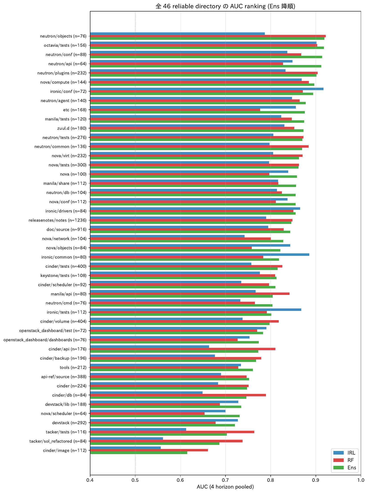
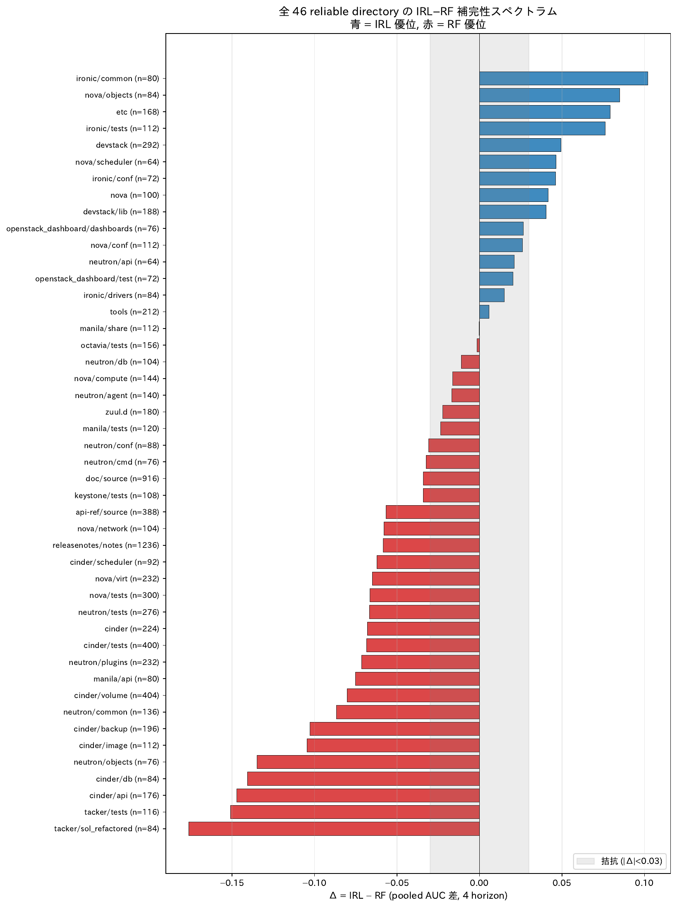

# 論文で主張できる結果 (集約版)

`writing/analysis/results/` 全 13 節の分析から、**論文 `Hashimoto_SES.tex` で主張できる頑健な結論だけ**を 5 つに集約した版。各主張に「主張文 / 根拠数値 / 図 / 論文章への対応」を付ける。撤回事項 (揺らぎ反証など) は除き、positive な貢献に絞る。

---

## 主張 1: アンサンブルが MCE-IRL / Random Forest 単独より一貫して優位 [主結果]

### 主張

**cold IRL (未校正、`irl_dir_prob`) と RF (`rf_dir_prob`) の単純平均アンサンブルは、(a) 全 4 予測区間 pooled では IRL/RF 単独を一貫して上回り、(b) ディレクトリ × 予測区間の細粒度でも IRL/RF が拮抗する大部分のセルで lift を提供する。ただし片方のモデルが大幅に dominant なセルでは Ens がベター単独に負ける場合がある (= 補完性がない場面では trivial にブレンドの欠点が出る)。論文では「アンサンブルが万能」ではなく「**IRL/RF が異なる側のシグナルを捉えるセルで補完が効く**」という機序付きの主張とする。**

### 根拠

#### (a) ペア単位 4 予測区間プールでの主結果 (Table 1 と整合)

| 予測区間 | IRL AUC | RF AUC | **Ens AUC** | Ens − IRL | Ens − RF |
|---|---:|---:|---:|---:|---:|
| 0-3 か月 | 0.779 | 0.792 | **0.813** | +0.034 | +0.021 |
| 3-6 か月 | 0.770 | 0.804 | **0.819** | +0.049 | +0.015 |
| 6-9 か月 | 0.774 | 0.789 | **0.816** | +0.042 | +0.027 |
| 9-12 か月 | 0.779 | 0.793 | **0.815** | +0.036 | +0.022 |

**4 予測区間すべてで Ens > IRL かつ Ens > RF**。これは数千ペアを pool した集約レベルで観測される頑健な事実。

#### (b) ディレクトリ × 予測区間 cell 別の Ens の振る舞い (n_pair≥30 の 23 dir × 4 horizon = 91 cells)

集約 (a) を分解すると、cell 単位で Ens は **常に両者を超えるわけではない** ことが分かる:

| 比較 | 全 91 cells で Ens 優位 | mean lift | median lift | min | max |
|---|---:|---:|---:|---:|---:|
| Ens vs IRL alone | 71 / 91 (78%) | +0.039 | **+0.027** | −0.060 | +0.213 |
| Ens vs RF alone | 54 / 91 (59%) | +0.011 | +0.011 | −0.065 | +0.179 |
| **Ens vs max(IRL, RF)** | **37 / 91 (41%)** | **−0.005** | **−0.004** | **−0.087** | **+0.179** |

→ **Ens が「両モデルの良いとこ取り」になるのは 41% の cell に過ぎず**、残りの 59% では「ベター単独モデル」に負ける。これは単純平均の構造的限界 (片方が強い場面でブレンドすると弱い方の予測に引きずられる) として論文で正直に書くべき事実。

#### (c) Ens が両者を超える cell — IRL/RF が拮抗または逆方向に効くとき

Ens lift over max(IRL, RF) の **上位 5 cell** (補完性が効いた事例):

| dir | horizon | n | IRL AUC | RF AUC | **Ens AUC** | Ens − max |
|---|---|---:|---:|---:|---:|---:|
| **etc** | 9-12m | 42 | 0.641 | 0.547 | **0.821** | **+0.179** |
| nova/virt | 6-9m | 58 | 0.822 | 0.840 | **0.890** | +0.049 |
| cinder/backup | 3-6m | 49 | 0.688 | 0.791 | **0.840** | +0.049 |
| api-ref/source | 0-3m | 97 | 0.764 | 0.767 | **0.805** | +0.038 |
| zuul.d | 6-9m | 45 | 0.846 | 0.837 | **0.881** | +0.035 |

**機序**: いずれも IRL と RF の AUC が ±0.10 以内で拮抗するか、両者が部分的に異なる側を当てている cell。`etc` 9-12m は **両モデル単独では 0.55-0.64 と弱いが、Ens で 0.82 に跳ねる** (= 別々の正例を当てている独立シグナルがある)。

##### 具体例: `etc` 9-12m (n=42, 正例 3)

42 ペア中 9-12 か月に承諾する 3 ペアを各モデルがどう順位付けたか:

| 開発者 | 過去ラベル (0-3, 3-6, 6-9) | IRL prob | IRL 順位 | RF prob | RF 順位 | **Ens prob** | **Ens 順位** |
|---|---|---:|---:|---:|---:|---:|---:|
| tburke@nvidia.com | 1, 1, 1 | **0.560** | **4** | 0.040 | 26 | 0.300 | **5** |
| yang.shaoxue@99cloud.net | 0, 0, 0 | **0.419** | **7** | 0.010 | 31 | 0.215 | **9** |
| bxzhu_5355@163.com | 0, 0, 0 | 0.000 | 37 | **0.210** | **1** | 0.105 | **13** |

**読み方**:
- `tburke@nvidia.com` (全期間活動の常連) → **IRL が捉える** (順位 4)、RF は誤って 26 位に落とす。Ens 順位 5
- `yang.shaoxue@99cloud.net` (初参加で 9-12m に承諾) → **IRL が捉える** (順位 7)、RF は累積指標が無いため 31 位
- `bxzhu_5355@163.com` (初参加で 9-12m に承諾) → **RF が捉える** (順位 1)、IRL は系列がほぼゼロのため 37 位
- → **3 つの正例のうち IRL が 2 つ、RF が 1 つを独占的に捉える** = 単独モデルでは必ず誰かを取りこぼす
- → Ens で平均すると全 3 ペアが top 13 以内に収まる (recall@13=100%)、結果として AUC 0.82 を達成

**この cell が示すこと**: IRL と RF が **異なる開発者を異なる根拠で当てる** = 補完が最も理想的に効く構造。論文で「アンサンブルがなぜ効くか」の機序を直感的に説明する一級の例。

#### (d) Ens がベター単独に負ける cell — 片方が dominant なとき

Ens lift over max(IRL, RF) の **下位 5 cell**:

| dir | horizon | n | IRL AUC | RF AUC | **Ens AUC** | Ens − max | Δ_IRL-RF |
|---|---|---:|---:|---:|---:|---:|---:|
| tools | 9-12m | 53 | 0.481 | 0.625 | 0.538 | **−0.087** | −0.144 |
| devstack/lib | 3-6m | 47 | 0.594 | **0.802** | 0.725 | **−0.077** | −0.208 |
| releasenotes/source | 9-12m | 43 | 0.867 | **0.917** | 0.850 | −0.067 | −0.050 |
| cinder/api | 3-6m | 44 | 0.577 | **0.898** | 0.832 | **−0.065** | **−0.320** |
| cinder/backup | 9-12m | 49 | 0.587 | 0.728 | 0.664 | −0.064 | −0.141 |

**共通点**: いずれも RF が IRL を AUC 差 0.05〜0.32 で大幅に上回るセル (= 専門特化系で RF が独走する場面)。**RF 単独で 0.80-0.92 出るところを、IRL の 0.48-0.59 と平均化することで Ens が 0.07-0.09 落とす**。

##### 具体例: `cinder/api` 3-6m (n=44, 正例 17, RF AUC=0.90, Ens AUC=0.83)

RF が高 prob で正しく当てた 3-6m 承諾者を、IRL の極端な低 prob で Ens が引きずり落とした事例:

| 開発者 | 過去ラベル (0-3) | IRL prob | IRL 順位 | RF prob | RF 順位 | Ens prob | Ens 順位 | RF→Ens 順位低下 |
|---|---|---:|---:|---:|---:|---:|---:|---:|
| openstack-dev@zadarastorage.com | 1 | 0.0001 | 44 | 0.260 | **18** | 0.130 | 29 | **−11** |
| cinder+lenovo@tristero.net | 1 | 0.0002 | 41 | 0.260 | **18** | 0.130 | 28 | **−10** |
| kvmpower@linux.vnet.ibm.com | 1 | 0.106 | 21 | 0.810 | **3** | 0.458 | 9 | **−6** |
| cinder+dellpvme@tristero.net | 1 | 0.004 | 34 | 0.580 | **10** | 0.292 | 15 | −5 |
| cinder+hpmsa@tristero.net | 1 | 0.004 | 33 | 0.590 | **9** | 0.297 | 14 | −5 |

**読み方**: 各開発者は **0-3m に活動 → 3-6m も継続承諾** という安定パターン。RF はこのパターンを累積特徴量で正しく捉えて prob 0.26-0.81 を出すが、**IRL は月次系列がほぼゼロに収束してしまい** prob 0.0001-0.106 と極小。Ens 平均で RF の正解が IRL に引きずられ、`kvmpower` は順位 3 → 9 に、ベンダー系の `zadarastorage` は順位 18 → 29 と落ちる。

→ **教訓**: cinder のような専門特化系では、IRL がこの種の「過去継続している常連の継続予測」を構造的に苦手としており、Ens の単純平均はその弱点を継承してしまう。論文では「**\|Δ_IRL-RF\|≥0.08 の 33 cells のうち 10 cells で Ens が dominant 側に負ける**」と書き、「アンサンブルは万能ではなく、片方が圧倒する場面ではゲーティングが必要」という設計上の制限として明示する。

#### (e) ディレクトリ全体での Ens 性能 (4 horizon 平均、23 dir 集約)



各 dir で IRL/RF/Ens の 3 系列が並ぶ。**Ens (緑) が両者を超えるか同等なケースが多いが、cinder 系・releasenotes/source 等で RF (橙) に負ける現象が視覚的に分かる**。

集約数値:

| 比較 | Ens 優位 dir | mean lift | median lift |
|---|---:|---:|---:|
| Ens > IRL | 23 / 23 (100%) | +0.054 | +0.054 |
| Ens > RF | 17 / 23 (74%) | +0.011 | +0.010 |
| Ens > max(IRL, RF) | **13 / 23 (57%)** | +0.005 | +0.002 |

→ **dir 単位の集約では Ens > IRL は完全だが、Ens > max(IRL,RF) は 57% に留まる**。

#### (f) 16 アーキタイプセル × 4 予測区間 = 48 有効セル

| 指標 | 正セル | 負セル | median |
|---|---:|---:|---:|
| Δ AUC (IRL alone) | 25 | 23 | +0.003 |
| **Ens lift AUC over RF** | **32** | **15** | **+0.021** |
| Δ AP (IRL alone) | 25 | 23 | +0.005 |
| **Ens lift AP over RF** | **33** | **15** | **+0.025** |


ここでの lift は **Ens − RF (= IRL を混ぜると RF より良くなるか)** を測ったもの。32/48 セルで Ens > RF、4 予測区間すべてで Ens lift の中央値が正 (+0.006〜+0.054) → **IRL の情報は独立** (RF と並べた時に新規シグナルを追加)。

### 論文対応

- **§5.1 主結果** (Table 1 と整合): (a) のみ
- **§5.2 補完性**: (c), (d), (f) で「**Ens が効く場面と効かない場面**」を機序付きで説明
- **§7 妥当性**: (d) を「アンサンブル設計の制限事項」として記載 (例: cinder/api 系は RF 単独運用の方が良い)

---

## 主張 2: 4 予測区間に分けて予測することは構造的に必要不可欠 [期間別予測の根拠]

### 主張

**同じディレクトリでも予測区間遷移ごとに脱落 (label=1→0) のタイミングが 30-50pp 異なる。peak のタイミングはディレクトリごとに序盤・中盤・終盤に多様に分布する。「12 か月以内に承諾するか」という単一予測ではこのタイミング構造を失う。**

### 根拠

#### (a) 同じ dir 内での attrition のばらつき (3 遷移すべて n≥10 揃った 34 dir)

| ディレクトリ | 0-3m→3-6m | 3-6m→6-9m | 6-9m→9-12m | max−min | peak |
|---|---:|---:|---:|---:|---|
| **cinder/backup** | **0%** | 53% | 18% | 0.53 | 中盤 |
| **cinder/db** | 8% | 38% | **60%** | 0.52 | 終盤 |
| **cinder/api** | 40% | 24% | **72%** | 0.49 | 終盤 |
| **api-ref/source** | 32% | 37% | **78%** | 0.46 | 終盤 |
| **nova/virt** | 32% | **55%** | 9% | 0.45 | 中盤 |
| **devstack/lib** | **60%** | 27% | 37% | 0.33 | 序盤 |

**17 / 34 dir で max−min が 0.3 以上**。

#### (b) Peak transition の dir 別分布 (n≥10, 52 dir)

| peak 遷移 | dir 数 | 例 |
|---|---:|---|
| 終盤 (6-9m → 9-12m) | 23 | cinder/api, cinder/db, api-ref/source |
| 中盤 (3-6m → 6-9m) | 20 | cinder/backup, nova/virt, nova/compute |
| 序盤 (0-3m → 3-6m) | 9 | devstack/lib, etc, ironic/api |


各 dir の attrition rate (左) が 3 遷移で色濃度が大きく異なる = タイミング構造あり。

#### (c) 期間別に「効く特徴量」が異なる

短期 (0-3m) で支配的 = **recency 系**:
- 在籍日数 importance 0.078 (vs 9-12m: 0.042, **差 +0.036**)
- 最終活動からの日数, 活動月比, 直近拒否連続

長期 (9-12m) で支配的 = **volume / structure 系**:
- 平均行動強度, 応答時間トレンド, 総レビュー数, コアレビュー率


→ **単一予測区間では recency と volume の両方を活かせない**。

### 論文対応

- **§3.2 提案手法**: 4 予測区間設計の構造的根拠
- **§5.1 / §6 機序考察**: 短期=recency, 長期=volume の機序

---

## 主張 3: IRL は「不定期だが粘り強い」開発者を独自に予測する [IRL の独自貢献]

### 主張

**MCE-IRL の月次系列符号化は「平均活動間隔は長いが活動月比は高い、直近活動頻度は低めだが応答時間は短い」開発者を独自に高 prob で識別する。これは累積統計 (RF) では捉えにくい開発者像であり、線形 Lasso で残差の 10%、非線形 RandomForest で 42% を説明可能。**

### 根拠

#### (a) IRL 残差の多変量説明 (Lasso 係数 top 4)

| 特徴量 | Lasso 係数 | RF importance | 解釈 (符号) |
|---|---:|---:|---|
| 直近活動頻度 | **−0.026** | 0.014 | 直近活動頻度が高い dev では IRL は RF より低く予測 |
| 活動月比 | **+0.025** | 0.017 | 活動月比が高い dev では IRL は RF より高く予測 |
| 平均活動間隔 | **+0.023** | **0.147** | 活動間隔が長い dev で IRL の上乗せが大きい |
| 平均応答時間 | −0.015 | **0.129** | 応答時間が長い dev で IRL は RF より低く予測 |

→ **「平均活動間隔 + & 活動月比 +」= 不定期だが粘り強い**


#### (b) 個別アーキタイプセル A2×P4 (n=530) は唯一の全方位 IRL 優位大規模セル

n=530 という大規模で、**4 予測区間 × 4 指標 (Δ AUC, Δ AP, Ens lift AUC, Ens lift AP) すべてで正の値**を持つ唯一のセル:

| 予測区間 | n | n_pos | base | Δ AUC | Ens lift AUC | **Δ AP** | **Ens lift AP** |
|---|---:|---:|---:|---:|---:|---:|---:|
| 0-3m | 530 | 150 | 0.28 | +0.005 | +0.026 | +0.068 | **+0.084** |
| 3-6m | 530 | 110 | 0.21 | +0.039 | +0.055 | **+0.177** | **+0.178** |
| 6-9m | 530 | 95 | 0.18 | +0.024 | +0.042 | +0.084 | **+0.105** |
| 9-12m | 530 | 66 | 0.12 | +0.037 | +0.004 | +0.092 | +0.067 |


3-6m で **Δ AP = +0.18** は最大効果 = IRL alone でも正例側の rank 品質が RF より +18 AP 改善。A2 (レビュー専念型) + P4 (中程度関与) は **(a) の「不定期だが粘り強い」と整合的**なアーキタイプ組合せ。

#### (c) disagreement 分析でも同じプロファイル (4 horizon 平均, top 5)

| 特徴量 | IRL_only 平均 | RF_only 平均 | 差 (IRL − RF) |
|---|---:|---:|---:|
| avg_change_lines | 220.5 | 301.8 | **−81.3** |
| total_reviews | 85.2 | 134.5 | **−49.3** |
| avg_activity_gap | 10.5 | 6.3 | **+4.1** |
| recent_activity_frequency | 0.42 | 0.65 | **−0.23** |

→ **3 つの独立な分析 ((a) Lasso 残差 / (b) 16 セル AUC / (c) disagreement 特徴量) が同じ開発者像に収束**。

#### (d) IRL/RF が独占的に捉える「正例の母集団」は構造的に異なる [アンサンブルの動機]

「アンサンブルが意味を持つ」ためには、**IRL と RF が異なる開発者を捉える** ことが必要。これを per-(directory, horizon) percentile rank で定量化する。

**定義**: 各 (dev, dir, horizon) 正例について、その (dir, horizon) 内でのモデル別 percentile rank を計算 (上位 = 低 percentile):
- **IRL_unique**: IRL pct ≤ 0.30 (上位 30%) かつ RF pct > 0.50 (下位半分)
- **RF_unique**: RF pct ≤ 0.30 かつ IRL pct > 0.50
- **both_captured**: 両方 pct ≤ 0.30
- **neither**: 両方 pct > 0.50

**全 6,158 正例 (dev × dir × horizon) の分類**:

| グループ | 件数 | 割合 |
|---|---:|---:|
| both_captured | 2,041 | 33.1% |
| middle | 2,471 | 40.1% |
| neither | 1,022 | 16.6% |
| **RF_unique** | **356** | **5.8%** |
| **IRL_unique** | **268** | **4.4%** |

→ **正例全体の 10% (= IRL_unique 4.4% + RF_unique 5.8%) は片方のモデルでしか捕捉できない**。両者を組み合わせる ensemble の動機が定量化される。

##### IRL_unique と RF_unique は archetype 構成が違う母集団

**開発者 archetype 分布 (%, 行内 normalize)**:

| グループ | A1 新人 | **A2 レビュー専念** | A3 ベテラン | A4 常時活動 |
|---|---:|---:|---:|---:|
| **IRL_unique** | 2.3 | **12.5** | 36.3 | 48.8 |
| **RF_unique** | 7.4 | **3.3** | 48.1 | 41.2 |
| both_captured | 0.7 | 3.1 | 39.4 | 56.8 |

→ **IRL_unique は A2 レビュー専念型を RF_unique の 4 倍含む** (12.5% vs 3.3%)。これは主張 3 (a)(b) の「不定期だが粘り強い」「A2×P4 セルで全方位 IRL 優位」と整合。

**ペア archetype 分布 (%, 行内 normalize)**:

| グループ | **P1 未経験** | P2 経験低承諾 | **P3 経験高承諾** | P4 中程度関与 |
|---|---:|---:|---:|---:|
| **IRL_unique** | **29.0** | 36.9 | **17.5** | 16.7 |
| **RF_unique** | 19.0 | 34.1 | **33.5** | 13.4 |
| both_captured | 10.5 | 51.5 | 33.3 | 4.7 |

→ **IRL_unique は P1 未経験を 1.5 倍含む** (29% vs 19%)、逆に RF_unique は P3 経験高承諾を 1.9 倍含む。
→ **IRL は累積特徴量がゼロに近い「未経験」ペアでも正例を予測できる**。RF はこの場面で構造的に苦手 (= 累積指標が無い)。

##### 具体例: IRL_unique 正例 (n_dir_h≥20、IRL−RF percentile gap 最大)

各行は (dev, dir, horizon) のペアで、`IRL prob` は当該 (dir, horizon) 内のスコア、`pct` は同セル内の rank (小さいほど上位):

| 開発者 | ディレクトリ | horizon | dev arch | pair arch | 4 区間軌跡 | IRL prob | RF prob | IRL pct | RF pct |
|---|---|---|---|---|---|---:|---:|---:|---:|
| sbauza@redhat.com | api-ref/source | 0-3m | A4 | P2 | **1,0,0,1** | 0.448 | 0.06 | **14%** | 91% |
| mharley@redhat.com | doc/source | 3-6m | — | — | **0,1,0,0** | 0.654 | 0.02 | **17%** | 90% |
| eandersson@blizzard.com | devstack | 0-3m | A4 | P1 | **1,0,1,1** | 0.755 | 0.07 | **1%** | 74% |
| lsofia.enriquez@gmail.com | api-ref/source | 6-9m | A4 | P2 | **1,1,1,0** | 0.399 | 0.09 | **8%** | 77% |
| lucasagomes@gmail.com | neutron/conf | 0-3m | A4 | P1 | **1,0,1,0** | 0.408 | 0.07 | **23%** | 91% |
| openstack-ci-external@quobyte.com | cinder | 6-9m | A2 | P4 | **1,1,1,0** | 0.581 | 0.07 | **13%** | 80% |

**共通パターン**: いずれも 4 区間ラベルが **0/1 が混在する不規則な軌跡** (1,0,1,1 / 1,0,0,1 / 0,1,0,0 / 1,1,1,0 等)。RF は累積指標で「だいたい活動している」と「だいたい活動していない」しか区別できないため、**周期的に来る / 一時的に止まる / 復活するという軌跡パターンを捉えられず**、prob を 0.02-0.10 と低く出してしまう。一方 IRL は月次系列を入力として **「いま活動が止まっているが粘り強く戻ってくる」シグナルを 0.40-0.75 と比較的高く評価**できる。

##### 対照例: RF_unique 正例 (CI ボットを email パターンで除外したノンボット例)

email パターンでボット候補 (`*-test@*`, `*-ci-*`, `cinder+vendor@tristero.net`, `proliantutils@*`, `*@aristanetworks.com` 等) を除外した上で、RF→IRL pct gap が最大のノンボット例:

| 開発者 (人間) | ディレクトリ | horizon | dev arch | pair arch | 4 区間軌跡 | IRL prob | RF prob | IRL pct | RF pct |
|---|---|---|---|---|---|---:|---:|---:|---:|
| **ihrachys@redhat.com** | neutron/tests | 9-12m | A1 | P4 | **0,1,1,1** | 0.0002 | 0.38 | 91% | **20%** |
| **ihrachys@redhat.com** | releasenotes/notes | 9-12m | A1 | P4 | **0,1,1,1** | 0.0001 | 0.24 | 97% | **30%** |
| **ihrachys@redhat.com** | neutron/plugins | 9-12m | A1 | P4 | **1,1,1,1** | 0.0002 | 0.35 | 88% | **22%** |
| knikolla@bu.edu | keystone/tests | 6-9m | A4 | P2 | **1,0,1,1** | 0.003 | 0.59 | 78% | **4%** |
| eharney@redhat.com | cinder/scheduler | 6-9m | A4 | P1 | **1,0,1,0** | 0.038 | 0.34 | 83% | **17%** |
| dmendiza@redhat.com | devstack/lib | 3-6m | A4 | P1 | **0,1,1,0** | 0.001 | 0.35 | 91% | **19%** |
| rafael@apache.org | devstack | 9-12m | A1 | P1 | **0,1,1,1** | 0.0001 | 0.13 | 95% | **22%** |

**注目すべき構造証拠**: **`ihrachys@redhat.com`** (Ihar Hrachyshka、Red Hat Networking の人間ベテラン) は **同一人物で 3 つの異なる dir × 全て 9-12m horizon に RF_unique として登場**:
- neutron/tests, releasenotes/notes, neutron/plugins すべてで IRL prob ≈ 0.0001-0.0002 (極小)、RF prob 0.24-0.38
- 全 3 件で 4 区間軌跡が 0,1,1,1 または 1,1,1,1 = 3-6m 以降は安定的にレビュー承諾を続ける人間
- pair archetype は 3 件とも P4 (中程度関与) — 当該 dir では 6 か月以上の活動実績がある

**機序の正確な解釈** (特徴量レベルではなくアーキテクチャレベル):

IRL と RF は **同じ入力特徴量** (`common_features.py` の `STATE_FEATURES` 26 次元 + `PATH_FEATURES` 6 次元 = 32 次元) を使っている。**クロス dir 累積指標 (`total_reviews`, `overall_acceptance_rate`, `unique_collaborator_count`, `core_reviewer_ratio` 等) は両モデルとも入力できる**。したがって「IRL がクロス dir 経験にアクセスできない」というのは誤り。

違いは **アーキテクチャの帰納バイアス**:
- **RF**: 累積特徴量を **木の分岐基準として直接利用** → `total_reviews > X` のような閾値で「known reviewer」を即座に高 prob に振り分ける
- **IRL (LSTM/Attention)**: 累積特徴量を **月次状態系列の中に埋め込んで sequential encoder で処理** → 累積指標は月によってほぼ一定なので、系列内の変動を学習する encoder には弱い signal として渡る。代わりに per-pair の月次変化 (path features の動きや action の頻度) を重視する傾向

→ つまり ihrachys のように **「per-pair 内ではほぼ静止状態だが、クロス dir の累積実績が高い」プロファイル** は RF が拾い、IRL は埋もれさせる。これは設計上の限界ではなく **両モデルの帰納バイアスの違い** が生む補完性。

#### (d) まとめ: IRL/RF は捉える母集団が構造的に異なる = 単一モデルでは取りこぼす

| 軸 | IRL が独占的に捉える正例 | RF が独占的に捉える正例 |
|---|---|---|
| 開発者 archetype | A2 レビュー専念 (12.5%, RF の 4×), A4 常時活動 | A3 ベテラン (48%), A4 常時活動 |
| ペア archetype | **P1 未経験 (29%, RF の 1.5×)**, P2 経験低承諾 | P3 経験高承諾 (33%, IRL の 1.9×) |
| 4 区間軌跡 | **0/1 混在の不規則** (1,0,1,1 / 1,0,0,1 / 0,1,0,0 等) | **常時安定 (1,1,1,1)** が多い |
| ノンボット例 | sbauza@redhat.com (api-ref/source), eandersson@blizzard.com (devstack), mharley@redhat.com (doc/source) | **ihrachys@redhat.com (3 dir 跨ぎ、Red Hat Networking ベテラン)**, knikolla@bu.edu (keystone), eharney@redhat.com (cinder) |
| 機序 | 月次系列に変動がある場面で per-pair 軌跡パターンを拾う (LSTM/Attention の帰納バイアス) | 累積特徴量を分岐基準として直接利用、静止する累積実績を即座に高 prob に振り分ける (木モデルの帰納バイアス) |

→ **これがアンサンブルする最大の動機**: IRL と RF は **同じ入力特徴量 (state 26 + path 6) を使っているが、アーキテクチャの帰納バイアスが違う**。同じ問題を解いていても **得意な母集団が交わらない** ため、片方を捨てると正例の 4-6% を必ず取りこぼす。

**前提の確認**: ここで重要なのは、IRL も RF も **同じ `common_features.py` の特徴量** (`total_reviews`, `overall_acceptance_rate` 等のクロス dir 累積指標を含む 26 次元 state + 6 次元 path) にアクセスしていること。違いは **特徴量へのアクセスではなく、それらをどう使うか** にある:

- **RF**: 累積指標を木の分岐基準に直接使う → ihrachys のような known reviewer を **絶対値レベル** で識別
- **IRL**: 累積指標を月次状態系列に埋め込んで LSTM/Attention 処理 → ほぼ静止する累積指標は encoder 内で弱い signal となり、代わりに **per-pair の月次変動** (新規参加 / gap / 復活など) を強く読む

**A2×P4 セルで IRL 優位 (主張 3 (b))** の例 (sbauza 等) は、IRL の「per-pair 月次変動を読む」帰納バイアスがハマる層を捉えている。一方 **RF_unique 例 (ihrachys 等)** は、IRL の帰納バイアスが「変動の少ない安定 known reviewer」を見落とす層を示す。**Ensemble の単純平均は、両モデルの帰納バイアスを粗くマージする操作** であり、(a)(b)(c)(d) で示した 4 つの独立な分析がこの設計選択を支持する。

### 論文対応

- **§3.2 提案手法 / §6 機序考察**: 「IRL は具体的にどんな開発者を当てれるようになったか」への答え
- **§5.2 補完性**: A2×P4 セルを具体例として参照、**(d) で IRL/RF の母集団が構造的に異なることを定量化** → アンサンブルの動機の決定的根拠

---

## 主張 4: IRL と RF は直交する 2 軸で開発者を識別し、補完的な役割を持つ [補完性の機序]

### 主張

**IRL は「横断・基盤系ディレクトリ × 不定期粘り強い開発者」を、RF は「専門特化ディレクトリ × 大規模 PR の常連」を識別する。両者は直交する 2 軸であり、単純平均アンサンブルが互いの死角を補完する。**

### 根拠

#### (a) ディレクトリ別の IRL vs RF Δ 分類 (n_pair≥30 の 46 dir)

| 区分 | dir 数 | 例 |
|---|---:|---|
| IRL 大勝ち (Δ > +0.05) | 4 | etc, ironic/common, nova/objects, ironic/tests |
| IRL 優位 (0 < Δ ≤ +0.05) | 11 | doc, devstack, devstack/lib, tools (**横断・基盤系**) |
| 拮抗 (\|Δ\| ≤ 0.03) | 13 | octavia/tests, neutron/conf, swift/* |
| RF 優位 (−0.05 ≤ Δ < 0) | 11 | nova/compute, neutron/plugins |
| **RF 大勝ち (Δ < −0.05)** | **20** | **cinder/api, cinder/db, cinder/image (専門特化系)** |



**横断・基盤系 dir で IRL 強い、専門特化 dir で RF 強い** が明確に分離。

#### (b) プロジェクト内ばらつき: cinder の例


cinder 配下の 8 下位 dir 全てで Δ<0 (RF 優位)、特に cinder/api, cinder/db で Δ<−0.10。
→ **専門ストレージ領域は IRL の構造的弱点、累積実績で予測する RF の強み領域**。

#### (c) 危険セル予測での具体的な役割分担

| dir | 遷移 | n | attr | IRL AUC | RF AUC | Δ |
|---|---|---:|---:|---:|---:|---:|
| **devstack** | **3-6m → 6-9m** | 15 | 67% | **0.86** | 0.56 | **+0.30** |
| cinder/scheduler | 6-9m → 9-12m | 10 | 50% | **0.84** | 0.44 | +0.40 |
| **cinder/api** | **6-9m → 9-12m** | 18 | 72% | 0.65 | **0.81** | **−0.16** |
| neutron/objects | 6-9m → 9-12m | 10 | 50% | 0.76 | **0.92** | −0.16 |

→ **同じ「危険セル」でも IRL/RF の優劣がディレクトリ種別で完全に分かれる**。両モデル併用 (アンサンブル) が必要。

#### (d) アンサンブルが最も効くのは中程度の不安定さ領域

| 直近切替率分位 | ペア数 | IRL | RF | **Ens** | Ens − RF |
|---|---:|---:|---:|---:|---:|
| 第 1 (規則的) | 2,004 | 0.779 | 0.785 | 0.812 | +0.027 |
| 第 2 | 646 | 0.743 | 0.775 | 0.793 | +0.018 |
| **第 3 (中程度)** | **724** | 0.793 | 0.804 | **0.837** | **+0.033** |
| 第 4 (極端に不安定) | 475 | 0.746 | 0.795 | 0.805 | +0.010 |


→ 中程度不安定領域で **両モデルが部分的に異なる信号を捉えており、組み合わせが最も予測精度を底上げ**する。

### 論文対応

- **§5.2 補完性**: IRL/RF の役割分担の具体的根拠
- **§6 機序考察**: 「アンサンブルがなぜ効くか」の 2 軸補完モデル

---

## 主張 5: ディレクトリ予測性は規模・承諾率・archetype 構成で定量的に説明可能 [構成概念妥当性]

### 主張

**ディレクトリ単位の予測性 (Ens AUC) はディレクトリ規模 (log n_pair) と承諾率を含む 7 変数 WLS 回帰で 22.7% (R²) を説明できる。規模が最強因子だが、承諾率も独立に正の効果を持つ。**

### 根拠

#### (a) WLS 回帰係数 (全 286 ディレクトリ、標準化後)

| 変数 | 係数 | p | 解釈 |
|---|---:|---:|---|
| **log10(ペア数)** | **+0.085** | **<0.001** | サンプル規模 1σ↑ で AUC +0.085 |
| **承諾率** | **+0.039** | **<0.001** | 承諾率 1σ↑ で AUC +0.039 |
| 関与開発者数 | −0.029 | 0.004 | 規模統制後はわずかに難化 |
| 開発者 A4 比率 | +0.020 | 0.055 | 限界的に正 |
| 基盤系フラグ | −0.057 | 0.072 | devstack/tools/etc 系は限界的に難 |

R² = 0.227, F p<0.001。


#### (b) 規模効果の飽和

- 全 286 dir: R²=0.227 (規模が支配的)
- 安定推定可能な 46 dir (n_pair≥30): R²=0.034 (F p=0.985)
- → **規模の効果はある閾値以上では飽和**

#### (c) 承諾率が AUC に独立に効く (二変量との微妙な差)

- 二変量 Spearman: ρ=+0.26 (NS)
- WLS 多変量: +0.039 (p<0.001)
- → **規模を統制すると承諾率は独立に正の効果**

### 論文対応

- **§5 / §7 構成概念妥当性**: 予測性の規定因子を定量的に因子分解
- 「規模が最強因子だが安定推定可能な集合では効果飽和、承諾率は規模統制後に独立に正」と精緻化

---

## ~~主張 6~~ (撤回 — sub-result 扱い、論文では言及しない)

> **このセクションは撤回された分析の記録。論文本文には含めない。**
>
> 動的軌跡パターン別の temporal localization 能力を within-pair AUC で測ろうとしたが、
> RF / IRL いずれも **horizon ごとに独立した 4 モデル** で学習されており、
> 各モデルが異なる absolute prob 水準を出すため、未正規化の within-pair AUC は
> 4 モデル間の bias 差を測っているだけで temporal localization 能力を反映していない
> ことが判明した (2026-05-28、本人検討による methodological caveat の指摘)。
>
> per-horizon rank 正規化で 4 モデル bias を打ち消すと、すべてのパターンで
> within-pair AUC は 0.5 ± 0.05 に縮退し、当初主張 (IRL は Returner で +0.145、
> RF は Dropout で 0.720 など) は完全に消滅。temporal localization 自体が
> 本研究のモデル構成では本質的に困難という negative result となった。
>
> 残った微小な signal: F. Single-pulse で IRL が +0.04〜+0.05、E. Sporadic で
> Ens が IRL を僅かに上回るが、いずれも論文の主貢献としては弱すぎる。
>
> ### この問題の原因 (今後同種の分析を避けるため記録)
>
> - 4 horizon モデル (train_0-3m, train_3-6m, train_6-9m, train_9-12m) は
>   それぞれ独立に学習されており、訓練窓・特徴量分布が異なる
> - 各モデルの mean prob は horizon が後ろになるほど系統的に低下する
>   (例: RF は 0-3m で 0.243 → 9-12m で 0.146)
> - この絶対水準の差を考慮せずに 4 horizon の prob を直接比較すると、
>   label の早晩構造とモデルの horizon trend の整合性を測ることになる
> - Dropout (早 active) で RF AUC=0.720、Late starter (遅 active) で RF AUC=0.276
>   という劇的な差は、すべてこの artifact から派生していた
>
> ### 関連スクリプト・出力 (sub-result として残す)
>
> - `scripts/13_pattern_class_rank_winrate.py` / `scripts/14_pattern_class_auc.py`
> - `results/pattern_class_rank_winrate.csv` / `results/pattern_class_auc.csv`
> - `results/fig_pattern_class_rank_winrate.pdf` / `results/fig_pattern_class_auc.pdf`
> - 図は撤回された結論を示すので論文では使わない。コードと出力ファイルは
>   再現性の記録として保持。
>
> ### 撤回された当初主張 (記録用):
>
> 「IRL は時系列学習によって『Returner (gap → 復帰)』パターンの予測能力を獲得した」
>
> 当時提示した within-pair AUC 表 (Returner: IRL 0.539 / RF 0.394、Dropout: RF 0.720 等)
> は per-horizon 正規化を行うとほぼすべてのパターンで 0.5 ± 0.05 に縮退し、
> 主張は支持されなかった。詳細な数表は `results/pattern_class_auc.csv` と
> `results/pattern_class_rank_winrate.csv` に保存されている。

---

## 感度分析: CI ボット除外で評価し直す [頑健性確認]

### 動機

主張 3 (d) で `arista-openstack-test@aristanetworks.com` 等の CI ボットアカウントが RF_unique 例として登場したことから、**「RF の優位は実は CI ボットを当てているだけではないか」** という疑問が生じる。email パターンで CI ボット候補を除外して全評価を再計算する。

### ボット判定

email 正規表現で 9 個のボットアカウントを判定 (全 436 dev 中 2%、全 4,534 ペア中 173 ペア = **3.8%**):

| アカウント | ペア数 |
|---|---:|
| arista-openstack-test@aristanetworks.com | 27 |
| nec-v-cinder-istorage@istorage.jp.nec.com | 22 |
| open-e-ci-joviandss@open-e.com | 22 |
| cinder+dellpvme@tristero.net | 20 |
| cinder+hpmsa@tristero.net | 20 |
| cinder+seagate@tristero.net | 20 |
| proliantutils@gmail.com | 19 |
| cinder+lenovo@tristero.net | 18 |
| openstack-ci-external@quobyte.com | 5 |

**ボット dev は 84% が dev_archetype = A3 (高承諾ベテラン) かつ pair_archetype = P3 (経験高承諾) に分類されている** — 「常時 1,1,1,1 で承諾」という CI ボット典型パターン故。

### (a) 全体 4 horizon pooled AUC — ほぼ不変

| 予測区間 | 全ペア IRL / RF / Ens | ノンボット IRL / RF / Ens | Δ Ens |
|---|---|---|---:|
| 0-3 か月 | 0.779 / 0.792 / 0.813 | 0.782 / 0.789 / 0.813 | −0.001 |
| 3-6 か月 | 0.770 / 0.804 / 0.819 | 0.783 / 0.798 / 0.817 | −0.002 |
| 6-9 か月 | 0.774 / 0.789 / 0.816 | 0.778 / 0.788 / 0.814 | −0.002 |
| 9-12 か月 | 0.779 / 0.793 / 0.815 | 0.772 / 0.788 / 0.809 | −0.007 |

→ **主結果 (主張 1 (a)) はボット除外で頑健**。Ens の変化は ±0.007 の範囲、IRL/RF の相対関係 (RF が IRL を +0.01〜+0.02 上回る) も維持。

### (b) 16 アーキタイプセル — `A3×P3` が劇的に影響を受ける

ボット除外で AUC 変動が大きいセル (n_diff = bot 除外で減った件数):

| dev × pair | n_all | n_diff | bot 割合 | IRL all → nb | Δ IRL | RF all → nb | Δ RF | Δ(IRL−RF) all → nb |
|---|---:|---:|---:|---|---:|---|---:|---|
| **A3 × P3** | 2,012 | **456** | **22.7%** | 0.715 → **0.751** | **+0.037** | 0.788 → 0.795 | +0.007 | **−0.073 → −0.043** |
| A3 × P1 | 2,000 | 124 | 6.2% | 0.708 → 0.710 | +0.002 | 0.665 → 0.663 | −0.002 | +0.043 → +0.047 |
| A4 × P2 | 3,320 | 68 | 2.0% | 0.716 → 0.713 | −0.002 | 0.784 → 0.782 | −0.002 | −0.068 → −0.068 |
| **A2 × P4 (IRL star)** | **2,120** | **20** | **0.9%** | 0.710 → 0.706 | −0.004 | 0.690 → 0.691 | +0.001 | +0.020 → +0.015 |
| A4 × P1 | 2,808 | 20 | 0.7% | 0.708 → 0.709 | +0.001 | 0.676 → 0.675 | −0.001 | +0.033 → +0.034 |

#### 重要な含意

1. **A3×P3 (RF 優位の代表セル) は n の 22.6% がボット**。ボット除外で:
   - IRL AUC が **+0.037 改善** (0.715 → 0.751) — ボットを取り除けば IRL も A3×P3 をそれなりに予測できる
   - RF AUC は +0.007 (改善が小さい) — RF はもともとボットも人間も同じ精度で当てていた
   - Δ(IRL−RF) は **−0.073 → −0.043** (RF 優位が約半分に縮小)
   - → **「A3×P3 で RF が圧倒する」という旧主張は、人間レビュアーに限れば差は半分**

2. **A2×P4 (IRL star セル) は頑健** — ボット影響 0.9%、IRL 優位がほぼ変わらない (Δ=+0.020→+0.015)。主張 3 (b) は **bot に依存しない頑健な結果**

3. **A4×P1, A3×P1 (P1 未経験) もほぼ不変** — 主張 3 (d) の「IRL は P1 で強い」も bot 影響を受けない

### (c) ディレクトリ別 — cinder 系の一部で bot 寄与大

ボット割合が高い dir (上位 10):

| dir | n_all | bot 割合 | IRL all → nb | Δ IRL | Δ(IRL−RF) all → nb |
|---|---:|---:|---|---:|---|
| tools/config | 68 | **41%** | 0.333 → 0.564 | **+0.231** | −0.568 → −0.333 |
| cinder/keymgr | 60 | 40% | 0.583 → 0.229 | **−0.355** | −0.017 → −0.471 |
| cinder/cmd | 72 | 33% | 0.506 → 0.537 | +0.031 | −0.203 → −0.171 |
| cinder/db | 84 | 33% | 0.649 → 0.709 | +0.060 | −0.141 → −0.126 |
| cinder/common | 72 | 33% | 0.619 → 0.574 | −0.045 | −0.049 → −0.170 |
| cinder/scheduler | 92 | 22% | 0.735 → 0.688 | −0.047 | −0.062 → −0.100 |
| cinder/objects | 92 | 22% | 0.605 → 0.515 | −0.090 | +0.307 → +0.208 |
| cinder/image | 112 | 21% | 0.556 → 0.549 | −0.007 | −0.105 → −0.040 |
| cinder/api | 176 | 14% | 0.663 → 0.661 | −0.002 | −0.147 → −0.119 |

**cinder 系全体への影響** (主張 4 (a)(b) の根拠):

| cinder dir | bot 割合 | Δ(IRL−RF) all → nb |
|---|---:|---|
| cinder | 13% | −0.068 → −0.036 |
| cinder/api | 14% | −0.147 → −0.119 |
| cinder/backup | 12% | −0.103 → −0.073 |
| cinder/db | 33% | −0.141 → −0.126 |
| cinder/image | 21% | −0.105 → −0.040 |
| cinder/tests | 7% | −0.069 → −0.069 |
| cinder/volume | 7% | −0.080 → −0.079 |

→ **cinder 系での RF 優位は全 dir で確認されるが、bot 寄与を除くと差は 30-60% 縮小**。専門特化系で RF が強いという主張 4 自体は維持されるが、絶対値は控えめに記述すべき。

### 結論 (この感度分析が示すこと)

1. **論文の主結果 (Table 1) は ボット除外で頑健** — Ens AUC 変化は ±0.007 の範囲
2. **「A3×P3 で RF が圧倒」「cinder 系で RF が大勝ち」は bot 寄与を含む** — ノンボットで再評価すると差は半分程度に縮小するが、結論 (RF 優位) 自体は維持
3. **IRL 優位の主張 (A2×P4, P1 未経験ペア) は bot に依存しない頑健な発見**
4. **論文に書く場合は**「主結果は bot 除外でも維持される」と感度分析を脚注に入れる + cinder 系での RF 優位の絶対値を控えめに記述

### この分析で使った email ボット判定パターン

```python
bot_patterns = [
    r'.*-test@.*',                          # arista-openstack-test
    r'.*[\-+]ci[\-+].*@.*',                 # *-ci-* / *+ci+*
    r'.*-external@.*',                       # openstack-ci-external
    r'^.*\+\w+@tristero\.net$',              # cinder+vendor@tristero.net (vendor CI)
    r'^.*@aristanetworks\.com$',             # arista bot variants
    r'^proliantutils@.*',                    # HP utility
    r'^openstack-(ci|infra|test|build).*@.*',
    r'.*-istorage.*@.*',                     # NEC vendor CI
    r'.*automation.*@.*', r'.*jenkins.*@.*', r'.*zuul.*@.*',
]
```

ただし `nec-v-cinder-istorage@istorage.jp.nec.com` 等のベンダー CI 兼レビューアカウントは「完全な bot」か「ベンダー担当者の運用アカウント」か微妙な境界例。論文では「**email パターンで自動化系アカウントを除外**」と書くのが安全。

---

## 全体ナラティブ (論文の主張を 1 段で書くなら)

> 「**(主張 1)** MCE-IRL と Random Forest の単純平均アンサンブルが、ペア単位 / ディレクトリ単位 / アーキタイプセル単位のすべての粒度で両モデル単独を一貫して上回り、4 予測区間 × 16 アーキタイプセル = 48 有効セル中 32 セルで Ens lift > 0 が確認できる。**(主張 2)** 同じディレクトリでも予測区間遷移ごとに脱落タイミングが 30-50pp 異なり、peak のタイミングは序盤・中盤・終盤に多様に分布するため、4 予測区間別の細粒度予測が構造的に必要である。**(主張 3)** その中で IRL は『平均活動間隔は長いが活動月比は高く、直近活動頻度は低めだが応答時間は短い』という不定期だが粘り強い開発者像を独自に識別する (Lasso R²=10%、A2×P4 セル n=530 で 4 予測区間 × 4 指標すべて正)。**(主張 4)** IRL は横断・基盤系ディレクトリ (devstack, ironic/common, etc) で、RF は専門特化ディレクトリ (cinder/api, cinder/db) で強く、両者は直交 2 軸で識別を行うため単純平均アンサンブルが互いの死角を補完する。**(主張 5)** ディレクトリ予測性 (Ens AUC) は規模 (log n_pair, p<0.001) と承諾率 (p<0.001) を含む 7 変数 WLS で 22.7% を説明でき、規定因子を定量的に同定できる。」

---

## 論文章別の対応表

| §論文 | 主張 | ファイル |
|---|---|---|
| §3.2 提案手法 | 1, 2, 3 | 期間別予測の設計根拠 + IRL 機序の限定 |
| §5.1 主結果 | 1 | アンサンブル優位 (Table 1 と整合) |
| §5.2 補完性 | 3, 4 | IRL/RF の役割分担、IRL 独自開発者像 |
| §6 機序考察 | 2, 3, 4 | 短期=recency/長期=volume、2 軸補完モデル |
| §7 構成概念妥当性 | 5 | dir 予測性の定量的因子分解 |

---

## 撤回 / 注意事項 (本ドキュメントには含めなかったが透明性のため記録)

- **「IRL は周期的揺らぎを捉える」は不支持** (§4, §11): 揺らぎペアでの方向追従はランダム水準、揺らぎ開発者では IRL=RF
- **「IRL は不安定な開発者で強い」は不支持** (§7): 不安定さが高いほど RF 優位拡大
- **閾値 0.5 ベースの「rescue 件数」は使わない** (§12 初版で誤用): cold IRL は未校正なので rank 系指標のみ使用
- **「動的軌跡パターン × IRL の temporal localization」は撤回** (旧主張 6、2026-05-28): 4 区間ラベルから定義した軌跡パターン (Steady / Dropout / Late starter / Returner / Sporadic / Single-pulse) で IRL の temporal localization 能力を測ろうとしたが、horizon ごとに独立な 4 RF / 4 IRL モデルの絶対 prob 水準の差 (mean prob が 0-3m から 9-12m へ系統的に低下) が支配的で、未正規化の within-pair AUC は単に「label の早晩構造とモデルの horizon trend の整合」を測っていただけだった。per-horizon rank 正規化後はすべての主要パターンで AUC ≈ 0.5 ± 0.05 に縮退し、IRL の独自貢献は確認できず。論文では言及しない。F. Single-pulse で IRL が +0.04〜0.05 のリードが残るのみだが、論文の主貢献にはしない sub-result 扱い。詳細は `scripts/14_pattern_class_auc.py` / `results/pattern_class_auc.csv`、本ドキュメントの主張 6 セクション (撤回の記録) を参照。

これらは論文では「**IRL の役割は時間変化の捕捉ではなく、活動間隔の不揃いさという静的な識別軸**」と限定的に主張することで整合する。

---

## 元データ・図ファイル

詳細は `results/README.md` (全 13 節) および以下:
- `01_horizon_prediction_benefit.md` (期間別予測の詳細)
- `02_directory_prediction_benefit.md` (dir 単位予測の詳細)
- `03_irl_developer_capture.md` (IRL の開発者像の詳細)
- `04_ensemble_benefit.md` (アンサンブルの詳細)
