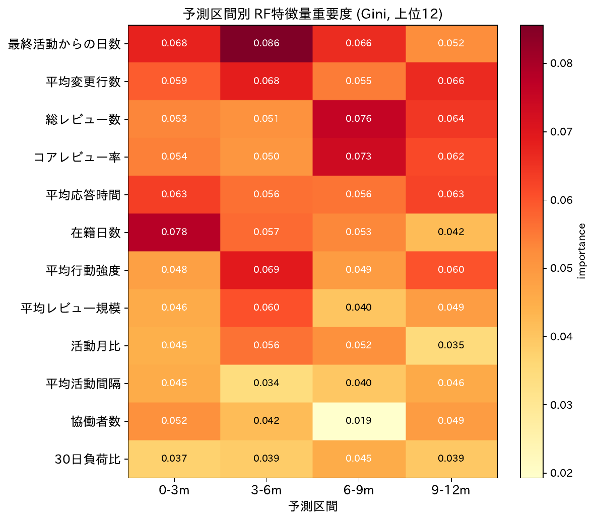

# 期間別予測のメリット

論文の主張: **「12 か月以内に承諾するか」の単一予測ではなく、4 つの予測区間 (0-3 / 3-6 / 6-9 / 9-12 か月) に分けて予測することの構造的意義**を示す。

---

## 1. 同じディレクトリでも「いつ脱落するか」が遷移ごとに大きく異なる (核となる構造的根拠)

### 図: ディレクトリ × 予測区間遷移の「危険セル」マップ

**読み方**:
- 縦軸: attrition rate (= 過去期間で承諾していたペアが次期間で承諾しなくなった割合) 上位 25 ディレクトリ
- 横軸: 3 つの予測区間遷移 (0-3m→3-6m, 3-6m→6-9m, 6-9m→9-12m)
- 左パネル: attrition rate (赤いほど脱落集中)
- 右パネル: Ens AUC (緑のほど予測しやすい)
- 各セルに値と n (= 過去期間の active 数) を注記

**ポイント**: 同じ行 (同じディレクトリ) で 3 つの遷移の色濃度が大きく異なる ⇒ ディレクトリごとに脱落のタイミングが違う。

### 主要な数値結果

3 遷移すべて n≥10 揃った 34 ディレクトリの中で、各ディレクトリ内での attrition rate の **max − min** (遷移間レンジ):

| ディレクトリ | 0-3m→3-6m | 3-6m→6-9m | 6-9m→9-12m | max−min | peak |
|---|---:|---:|---:|---:|---|
| **cinder/backup** | **0%** | 53% | 18% | 0.53 | 中盤 |
| **cinder/db** | 8% | 38% | **60%** | 0.52 | 終盤 |
| **cinder/api** | 40% | 24% | **72%** | 0.49 | 終盤 |
| **api-ref/source** | 32% | 37% | **78%** | 0.46 | 終盤 |
| **nova/virt** | 32% | **55%** | 9% | 0.45 | 中盤 |
| nova/objects | 29% | **40%** | 0% | 0.40 | 中盤 |
| **devstack/lib** | **60%** | 27% | 37% | 0.33 | 序盤 |
| manila/db | 25% | 18% | **50%** | 0.32 | 終盤 |

→ **17 / 34 ディレクトリで max−min が 0.3 以上**。同じ dir でも遷移ごとに 30-50pp も脱落率が変わる。

### Peak transition の分布 (n≥10, 52 dir)

| peak 遷移 | dir 数 | 例 |
|---|---:|---|
| **終盤 (6-9m → 9-12m)** | **23** | cinder/api, cinder/db, api-ref/source, manila/db, ironic/tests |
| 中盤 (3-6m → 6-9m) | 20 | cinder/backup, nova/virt, nova/objects, nova/compute |
| 序盤 (0-3m → 3-6m) | 9 | devstack/lib, etc, ironic/api |

**peak のタイミングがディレクトリごとに多様**なため、12 か月一発予測ではこの構造を全部失う。

---

## 2. 期間別に「効く特徴量」が変わる

### 図: 期間別特徴量重要度

**読み方**: 縦軸 = 上位 12 特徴量 (4 予測区間平均 importance で選択)、横軸 = 4 予測区間。セルの色濃度 = Gini importance。

**ポイント**: 左列 (0-3m) で濃い「在籍日数」「最終活動からの日数」が右へ行くと薄くなり、代わりに右列 (9-12m) で「総レビュー数」「平均行動強度」「コアレビュー率」が濃くなる → **recency 系 → volume 系へのシフト** が視覚的に確認できる。

### 主要な数値結果

短期 (0-3m) で特に効く特徴量:

| 特徴量 | 0-3m | 9-12m | 差 |
|---|---:|---:|---:|
| 在籍日数 | 0.078 | 0.042 | **+0.036** |
| 最終活動からの日数 | 0.068 | 0.052 | +0.015 |
| 活動月比 | 0.045 | 0.035 | +0.010 |

長期 (9-12m) で特に効く特徴量:

| 特徴量 | 0-3m | 9-12m | 差 |
|---|---:|---:|---:|
| 平均行動強度 | 0.048 | 0.060 | **−0.012** |
| 応答時間トレンド | 0.037 | 0.049 | −0.012 |
| 総レビュー数 | 0.053 | 0.064 | −0.011 |
| 平均変更行数 | 0.059 | 0.066 | −0.008 |

→ **短期 = 直近性が支配、長期 = 累積量・構造的地位が支配**。**異なる時間粒度で異なる予測機序が働く**ため、単一予測ではこの両方を同時に扱えない。

---

## 3. 危険セルでの脱落者捕捉率

### 図: 上位 5 危険セルでの recall@K 曲線

**読み方**: 5 つのパネル (上位 5 危険セル)、横軸 = 取得割合 K/n、縦軸 = 脱落者捕捉率 (recall)。グレー破線 = ランダム水準。黒破線 = K = n_attrited の境界。

**ポイント**: 多くのセルで IRL / RF / Ens の曲線がランダム水準を上回り、特に K が小さい領域 (=「上位数件だけ取りたい」推薦運用) で大きく上回る = 「事前にこの dir のこの期間で脱落しそうな人を絞り込める」。

### 主要な数値結果

attrition≥0.5 の **19 危険セル** で recall@K (K=n_attrited) の lift over random:

| 指標 | mean | median | 正のセル数 |
|---|---:|---:|---:|
| Ens recall lift | +7.8% | +8.3% | **16 / 19** |
| IRL recall lift | +7.7% | +6.7% | 14 / 19 |
| RF recall lift | +10.1% | +9.2% | 15 / 19 |

最大 lift +30% (neutron/objects 6-9m→9-12m, cinder/scheduler 6-9m→9-12m) — ランダム抽出より大幅に脱落者を捕捉。

---

## 4. 期間別 × アーキタイプセル別の補完性

### 図: 予測区間 × 16 アーキタイプセルの Ens lift AP

**読み方**: 4 パネル (左から 0-3m, 3-6m, 6-9m, 9-12m)、各パネル 4×4 ヒートマップ。色 = Ens AP − RF AP (正 = IRL を混ぜると正例 rank 品質改善)。

**ポイント**: **4 予測区間すべてで Ens lift の中央値が正**であり、IRL の独立情報量は予測区間に依存せず存在する。ただし「どのセルで効くか」は予測区間ごとに異なる:

- 短期 (0-3m, 6-9m): 多くのセルで Ens lift が正
- 3-6m: IRL alone は負だが Ens lift は中央値正 → ブレンドで救われる

---

## まとめ: 期間別予測のメリット (3 点)

1. **タイミング構造の保持**: 同じ dir でも遷移ごとに attrition が 30-50pp 異なる。**peak のタイミングを dir 別に当てる**には期間別予測が必要不可欠
2. **異なる予測機序の同時運用**: 短期は recency 系、長期は volume 系の特徴量が支配 → 1 つの予測区間では片方しか活かせない
3. **危険セル予測の実用性**: 危険セル 19 件中 16 件で脱落者を事前に低 prob に並べる能力を発揮、最大 +30% の lift

→ 論文の「**なぜ 4 区間に分けて予測するか**」の構造的根拠として、この 3 点を §3.2 や §5.1 で主張可能。

---

## 出典分析

- §2 期間別特徴量重要度 → `scripts/02_horizon_feature_importance.py`
- §12 horizon × archetype セル → `scripts/11_horizon_archetype_irl_rescue.py`
- §13 dir × 遷移 attrition マップ → `scripts/12_horizon_dir_attrition.py`

詳細は `results/README.md` の §2, §12, §13 を参照。
