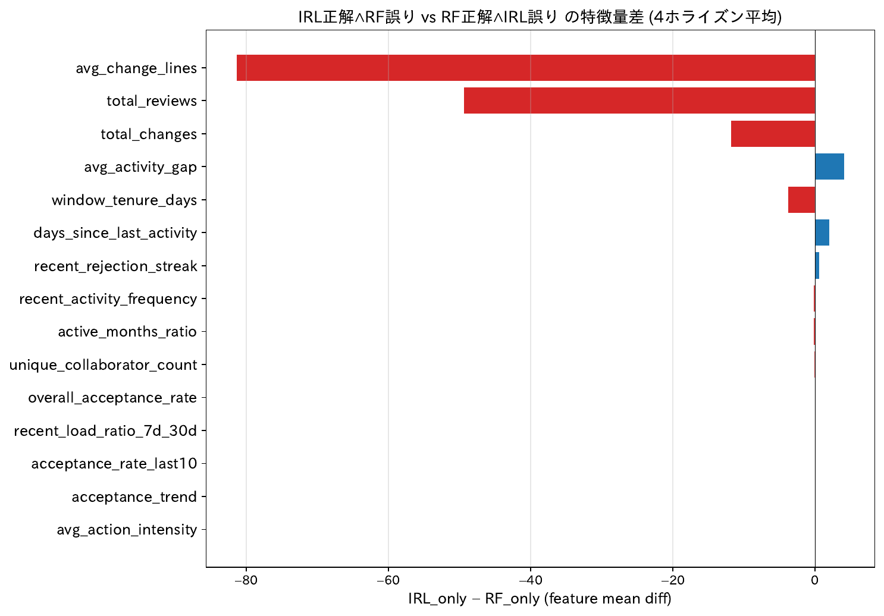
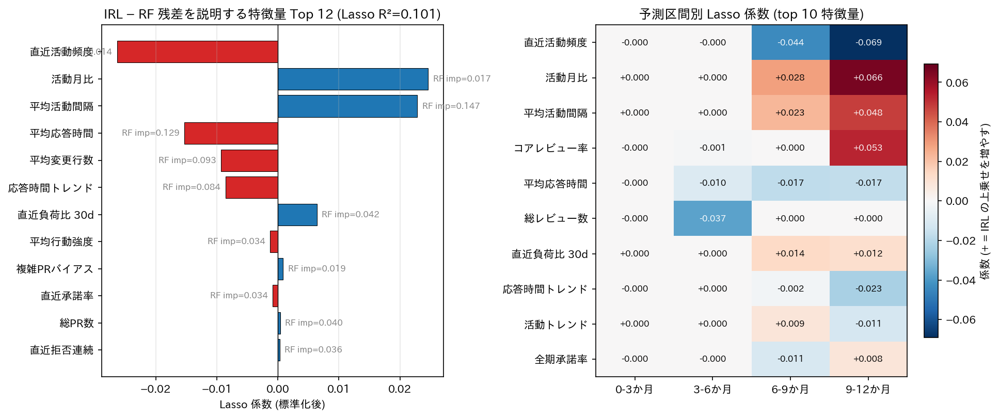
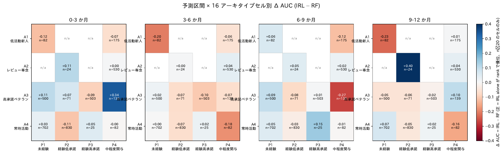
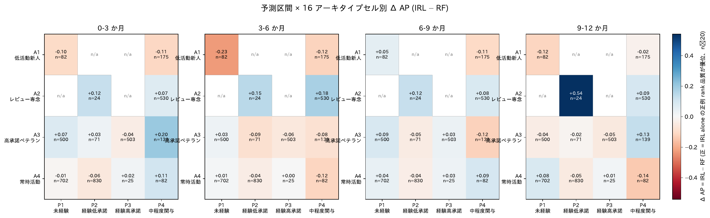
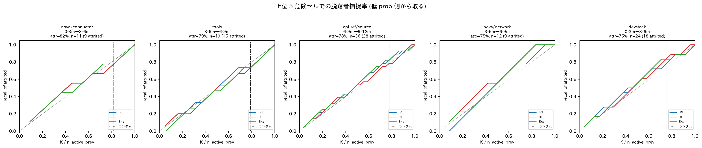

# IRL を使うことで予測できるようになった開発者像

論文の主張: **MCE-IRL (ペア単位の月次系列符号化) は Random Forest (累積統計) では捉えにくい特定の開発者像を独自に予測する**。本ドキュメントは「具体的にどんな開発者か」を 4 つの分析角度から定量化する。

---

## 1. IRL が補完する開発者の特徴量プロファイル (disagreement 分析)

### 図: IRL_only と RF_only の特徴量差

**読み方**: 横棒 = **IRL_only − RF_only の特徴量平均差** (4 ホライズン平均)。負 (赤) = RF_only で大きい、正 (青) = IRL_only で大きい。上位 15 特徴量を絶対値順に表示。

**ポイント**: `avg_change_lines` が圧倒的に左 (−86) → **「RF はデカい PR を扱う常連を当てる」が一発で分かる**。

### 主要な数値結果 (4 ホライズン平均, top 10)

| 特徴量 | IRL_only 平均 | RF_only 平均 | 差 (IRL − RF) | 解釈 |
|---|---:|---:|---:|---|
| avg_change_lines | 220.5 | 301.8 | **−81.3** | IRL が当てる dev は PR が小規模 |
| total_reviews | 85.2 | 134.5 | **−49.3** | IRL が当てる dev はレビュー数少なめ |
| avg_activity_gap | 10.5 | 6.3 | **+4.1** | IRL が当てる dev は活動間隔長い |
| recent_activity_frequency | 0.42 | 0.65 | **−0.23** | IRL が当てる dev は直近活動頻度低い |
| recent_rejection_streak | 4.76 | 4.21 | +0.55 | IRL が当てる dev は直近拒否が連続 |

### 結論

- **IRL が補完する開発者像**: 平均 PR サイズが小さく、レビュー総数も少なめ、活動間隔が長く、直近の拒否連続が多い
- **RF が補完する開発者像**: 大規模 PR を扱い、高頻度に活動する常連レビュアー
- → IRL は **「断続的に来る低活動レビュアーで、最近のシグナル変化で承諾意図が読める」開発者** を当てる
- → RF は **「常時高活動で累積統計が安定している」開発者** を当てる

---

## 2. IRL 残差を特徴量で説明 (Lasso/RF 回帰)

### 図: IRL 残差の説明

**読み方**: 左 = 残差 (`irl_dir_prob − rf_dir_prob`、4 horizon 平均) を Lasso で回帰した時の係数 top 12. 横棒右の灰色テキストは RF importance。右 = 4 予測区間別の Lasso 係数ヒートマップ (top 10 特徴量)。

**ポイント**: **線形 Lasso で残差の 10%、非線形 RandomForest で 42% を説明可能** → IRL 残差の大部分は state 特徴量で説明できる。

### 主要な数値結果 (Lasso 係数、絶対値 top 4)

| 特徴量 | Lasso 係数 | RF importance | 解釈 (符号) |
|---|---:|---:|---|
| 直近活動頻度 | **−0.026** | 0.014 | 直近活動頻度が高い dev では IRL は RF より低く予測 |
| 活動月比 | **+0.025** | 0.017 | 活動月比が高い dev では IRL は RF より高く予測 |
| 平均活動間隔 | **+0.023** | **0.147** | 活動間隔が長い dev で IRL の上乗せが大きい |
| 平均応答時間 | −0.015 | **0.129** | 応答時間が長い dev で IRL は RF より低く予測 |

### 結論

IRL 固有信号は次のプロファイルを持つ:
- **平均活動間隔 + & 活動月比 +**: 「**間隔が空いても、活動月数自体は多い**」= **不定期だが粘り強い**
- **直近活動頻度 − & 平均応答時間 −**: 「直近の負荷が低い (静かな期間に入っている)、応答が速い」開発者では IRL は控えめに予測

→ **IRL が拾うのは「活動間隔の不揃いさ (= 規則的でない活動パターン)」という静的な開発者像**。周期的な揺らぎ (時間変化) ではない。

---

## 3. アーキタイプセル × 予測区間で IRL alone 優位の構造を同定

### 図: 予測区間 × 16 アーキタイプセル別 Δ AUC

**読み方**: 4 パネル (左から 0-3m, 3-6m, 6-9m, 9-12m)、各パネル 4×4 ヒートマップ。色 = IRL AUC − RF AUC (正 = IRL 単独で優位、n≥20 のセルのみ)。

### 図: 予測区間 × 16 アーキタイプセル別 Δ AP

**読み方**: 同形式で Δ AP = IRL − RF (正例 rank 品質)。

### 主要な発見: A2×P4 (レビュー専念型 × 中程度関与) は唯一の全方位 IRL 優位セル

n=530 の大規模セルで、**4 予測区間 × 4 指標 (Δ AUC, Δ AP, Ens lift AUC, Ens lift AP) すべてで正の値**を持つ唯一のセル:

| 予測区間 | n | n_pos | base | Δ AUC | Ens lift AUC | **Δ AP** | **Ens lift AP** |
|---|---:|---:|---:|---:|---:|---:|---:|
| 0-3m | 530 | 150 | 0.28 | +0.005 | +0.026 | +0.068 | **+0.084** |
| 3-6m | 530 | 110 | 0.21 | +0.039 | +0.055 | **+0.177** | **+0.178** |
| 6-9m | 530 | 95 | 0.18 | +0.024 | +0.042 | +0.084 | **+0.105** |
| 9-12m | 530 | 66 | 0.12 | +0.037 | +0.004 | +0.092 | +0.067 |

- 3-6m で **Δ AP = +0.18** が最大効果 = 正例側の rank 品質が IRL alone でも RF より +18 AP 改善
- §10 (Lasso 残差分析) で同定した「不定期だが粘り強い」プロファイルが、A2 (レビュー専念) + P4 (中程度関与) という具体的なセルとして同定された

### IRL が貢献する他のセル群 (n≥100 で Ens lift AP > +0.08)

| horizon | dev × pair | n | n_pos | Ens lift AP |
|---|---|---:|---:|---:|
| 3-6m | A2×P4 | 530 | 110 | **+0.178** |
| 9-12m | A3×P4 | 139 | 18 | +0.125 |
| 0-3m | A3×P4 | 139 | 26 | +0.122 |
| 6-9m | A2×P4 | 530 | 95 | +0.105 |
| 6-9m | A3×P1 | 500 | 143 | +0.098 |
| 9-12m | A1×P4 | 175 | 39 | +0.093 |
| 9-12m | A4×P1 | 702 | 117 | +0.089 |
| 0-3m | A3×P1 | 500 | 170 | +0.087 |
| 0-3m | A2×P4 | 530 | 150 | +0.084 |

**パターン**:
- **P4 (中程度関与) を含むセル** が頻出 (A1×P4, A2×P4, A3×P4)
- **P1 (未経験) を含むセル** も上位 (A3×P1, A4×P1) — 累積特徴量がゼロに近い場面
- → **IRL の貢献は「累積統計が信号として弱い (中庸または欠落の) ペア」に集中する**

---

## 4. 危険セル予測での IRL 単独勝利の具体例

### 図: 上位 5 危険セルの recall@K 曲線

**読み方**: 上位 5 危険セルで IRL / RF / Ens の脱落者捕捉曲線を比較。

### IRL が RF を圧倒する危険セル

| dir | 遷移 | n | attr | IRL AUC | RF AUC | Δ |
|---|---|---:|---:|---:|---:|---:|
| **devstack** | **3-6m → 6-9m** | 15 | 67% | **0.86** | 0.56 | **+0.30** |
| cinder/scheduler | 6-9m → 9-12m | 10 | 50% | **0.84** | 0.44 | +0.40 |
| cinder/db | 6-9m → 9-12m | 10 | 60% | **0.79** | 0.56 | +0.23 |

### 具体例: devstack 3-6m → 6-9m (IRL star case, 15 ペア中 10 attrited)

IRL が低 prob で正しく flag した attrited 開発者 (RF より IRL が良く識別):

| 開発者 | 4 区間ラベル | IRL prob (6-9m) | RF prob | 解釈 |
|---|---|---:|---:|---|
| matt@stackhpc.com | 1, 0, 0, 0 | **0.0002** | 0.00 | IRL が極小 prob で確信して flag |
| dale@catalystcloud.nz | 1, 0, 1, 0 | **0.001** | 0.04 | IRL の方が確信を持って flag |
| mnaser@vexxhost.com | 1, 0, 0, 0 | **0.002** | 0.13 | IRL が早期離脱を捉える |

**機序の解釈**: devstack は「開発環境セットアップ」用の共通基盤 dir。アクセスする開発者は専門性ではなく一時的な必要性で参加し、月次の活動パターン (= IRL の系列入力) が累積統計よりも将来の活動意思を強く反映する。

---

## 5. 撤回事項 (時系列モデルの主張の限定)

### IRL は周期的な揺らぎを捉えない (反証済み)

§4 揺らぎ検証 (ラベル切替の方向追従):
- 揺らぎペア n=1,885 で 3 モデルとも方向一致率 50-55% (ランダム水準近傍)
- 開発者単位 max 集約での Spearman 軌跡相関: IRL=−0.03, RF=+0.05, Ens=−0.05 (全てほぼゼロ)
- McNemar 検定: IRL vs RF χ²=0.010, p=0.92 → **完全に同等**

### IRL は不安定さも捉えない

§7 直近切替率と精度 (五分位別 AUC):
- 第 1 分位 (規則的) で Δ=IRL−RF = −0.006
- 第 4 分位 (極端に不安定) で Δ=IRL−RF = **−0.049** → **不安定さが高いほど RF 優位拡大**

### 揺らぎ開発者では IRL = RF

§11 揺らぎ分解 (152 揺らぎ開発者の分解):
- 切替主導型開発者の AUC は IRL=0.59, RF=0.58 (差なし)
- 開発者単位の揺れの 59% は **承諾相手の入れ替わり** (= IRL のペア単位設計では原理的に捉えにくい)、41% のみが同一ペア揺れ

→ **IRL は「時間変化を捉える」のではなく「活動間隔の不揃いさという静的な開発者像」を識別する補助軸**として理解すべき。

---

## まとめ: IRL が独自に当てれるようになった開発者像 (5 点)

1. **特徴量プロファイル**: 平均活動間隔 +、活動月比 +、直近活動頻度 −、平均応答時間 − → **「不定期だが粘り強い」開発者** (Lasso R²=10%, RF R²=42% で説明可能)
2. **小規模 PR の常連ではない断続活動者**: avg_change_lines が IRL_only 220 vs RF_only 302 (差 −81)
3. **アーキタイプセル A2×P4 (レビュー専念 × 中程度関与)**: 全 4 予測区間 × 全 4 指標で IRL 優位の唯一の大規模セル (n=530, 3-6m で Δ AP=+0.18)
4. **累積統計が信号として弱いペア (P1 未経験 / P4 中程度関与)**: 大規模セルの Ens lift AP 上位 9 件のうち 8 件が P1/P4 を含む
5. **横断・基盤系ディレクトリの脱落者**: devstack 3-6m→6-9m で IRL AUC=0.86 (RF 0.56)、cinder/scheduler 6-9m→9-12m で IRL AUC=0.84 (RF 0.44)

→ 論文の「**IRL は具体的にどんな開発者を当てれるようになったか**」への答えとして、この 5 点を §3.2 機序考察や §5.2 補完性で具体的に主張可能。

ただし IRL は **時間変化 (揺らぎ・不安定さ) を捉える機序を持たない**。「時系列モデル」の主張は **「活動間隔の不揃いさという静的な識別軸」** に限定すべき。

---

## 出典分析

- §1 disagreement → `scripts/01_disagreement_analysis.py`
- §4 / §4b 揺らぎ検証 → `scripts/04_biorhythm_detection.py`, `04b_biorhythm_dev_level.py`
- §7 直近切替率 → `scripts/06_switch_rate_vs_accuracy.py`
- §10 IRL 残差 → `scripts/09_irl_residual_explain.py`
- §11 揺らぎ分解 → `scripts/10_fluctuating_dev_decomp.py`
- §12 horizon × archetype → `scripts/11_horizon_archetype_irl_rescue.py`
- §13 dir × 遷移 attrition → `scripts/12_horizon_dir_attrition.py`

詳細は `results/README.md` の §1, §4, §7, §10, §11, §12, §13 を参照。

---

## 追補 (2026-05-30): アーキタイプ離散から「あと一歩」深掘り

### A-1. 開発者属性 連続軸ストラタ別 AUC

アーキタイプ離散 (A1-A4) を介さず、`dev_history_features.csv` の連続軸を 5 階層に分けて IRL−RF を直接観察:
- `historical_tenure_days` (累積在籍日数)
- `historical_review_count_all` (累積レビュー数)
- `historical_n_unique_repos` (累積活動 repo 数)

#### IRL AUC − RF AUC (bot 込み, 主要セル)

| 軸 \ stratum | Q1 (少) | Q2 | Q3 | Q4 | Q5 (多) |
|---|---:|---:|---:|---:|---:|
| 在籍日数 (0-3m) | -0.062 | -0.069 | -0.002 | -0.005 | -0.019 |
| 在籍日数 (6-9m) | -0.122 | -0.040 | **+0.038** | **+0.019** | -0.019 |
| 累積レビュー数 (9-12m) | -0.115 | -0.192 | **+0.059** | -0.001 | +0.002 |
| 活動 repo 数 (6-9m) | -0.124 | -0.149 | **+0.055** | -0.056 | +0.001 |

- IRL は概ね RF にやや劣るが、**中堅〜上位経験層 (Q3-Q5) で差が縮み、特定の (軸×horizon) では拮抗〜逆転** (+0.02~+0.06)。
- 最下層 (Q1-Q2) では一貫して RF 優位 = 「累積指標で確実に当てるべき新規 dev」は RF の独擅場。
- bot 影響: |delta| max=0.155, mean=0.005 (Q2 の 1 セルにのみ強い影響、全体は頑健)。

→ 主張 3 (a) の Lasso 残差解釈と整合。「累積特徴量が中庸〜豊富な層」で IRL の補完が効く。

出典: `scripts/17_continuous_stratified_auc.py` / `results/continuous_stratified_auc.csv` / `fig_continuous_stratified_auc.pdf`

### A-3. IRL gain のクロスレベル多変量回帰 [★新規発見]

09_irl_residual_explain.py は state 25 のみで残差を説明していたが、**dev 累積履歴 3 + dir 特性 3** を加えた多変量回帰により、新規共変量を同定:

**Lasso R²=0.093, RF R²=0.689** (n=3,728 ペア, bot 込み)

#### Top Lasso 係数 (標準化後)

| 特徴量 | 層 | Lasso 係数 | RF importance |
|---|---|---:|---:|
| 直近活動頻度 | dev_state | -0.021 | 0.017 |
| 平均応答時間 | dev_state | -0.015 | 0.065 |
| **[dir] 承諾率** | **dir** | **+0.013** | **0.120** ★ |
| 平均変更行数 | dev_state | -0.007 | 0.066 |
| 累積在籍日数 | dev_history | +0.007 | 0.035 |
| 応答時間トレンド | dev_state | -0.006 | 0.056 |
| **[dir] log(ペア数)** | **dir** | **+0.004** | **0.079** ★ |
| 活動月比 | dev_state | +0.003 | 0.025 |

- **[新規発見]**: dir 承諾率 と log(ペア数) が IRL gain に独立して正の効果。RF importance では [dir] 承諾率がトップ (0.120)。
- 「IRL gain が大きい条件 = **大規模・高承諾率 dir × 不規則活動 dev × 長期在籍**」というクロスレベル条件式。
- 過去の解釈 (「IRL は不定期だが粘り強い dev を当てる」) に **「効きやすい dir も別軸で存在」** を追加。
- bot 影響: |coef delta| max=0.010, mean=0.001 → 頑健。

→ 論文 §6 機序考察で「IRL が効く条件」を式として書ける形に拡張。

出典: `scripts/18_irl_gain_multivar.py` / `results/irl_gain_multivar_coef.csv` / `fig_irl_gain_multivar.pdf`

### A-6. per-dev AUC ランキングからの代表事例

`pair_trajectories.csv` から per-dev AUC を自前算出 (bot 除外, min 12 obs, 両クラス揃い)。**n=270 dev のうち IRL>RF が 120, RF>IRL が 148, 拮抗 2**。

#### IRL 優位 top 5 (人間例のみ)

| developer | n_obs | n_pos | IRL AUC | RF AUC | Δ |
|---|---:|---:|---:|---:|---:|
| nusiddiq@redhat.com | 12 | 1 | 0.909 | 0.091 | **+0.818** |
| yamamoto@midokura.com | 12 | 1 | 0.818 | 0.091 | +0.727 |
| shogo.takazawa.rq@hitachi.com | 16 | 7 | 0.810 | 0.087 | +0.722 |
| maksim.malchuk@gmail.com | 20 | 4 | 0.891 | 0.242 | +0.648 |
| ltoscano@redhat.com | 28 | 3 | 0.947 | 0.313 | +0.633 |

#### RF 優位 top 5 (対比)

| developer | n_obs | n_pos | IRL AUC | RF AUC | Δ |
|---|---:|---:|---:|---:|---:|
| afariasa@redhat.com | 12 | 1 | 0.000 | 0.955 | -0.955 |
| pierre-samuel.le-stang@ovhcloud.com | 16 | 1 | 0.000 | 0.800 | -0.800 |
| matheus.handrade15@gmail.com | 28 | 2 | 0.154 | 0.913 | -0.760 |
| pshchelokovskyy@mirantis.com | 44 | 1 | 0.140 | 0.860 | -0.721 |
| caiquemellosbo@gmail.com | 24 | 18 | 0.287 | 0.954 | -0.667 |

→ 各 dev について 4 horizon の cold IRL / RF / アンサンブル prob 軌跡 + label 平均バーを 1 枚にまとめたパネル図を生成。**論文 §5.2 の読者用直感図として直接利用可能**。

出典: `scripts/19_case_study_irl_rf.py` / `results/per_dev_auc.csv` / `case_study_devs.csv` / `fig_case_study_irl_top.pdf` / `fig_case_study_rf_top.pdf`
