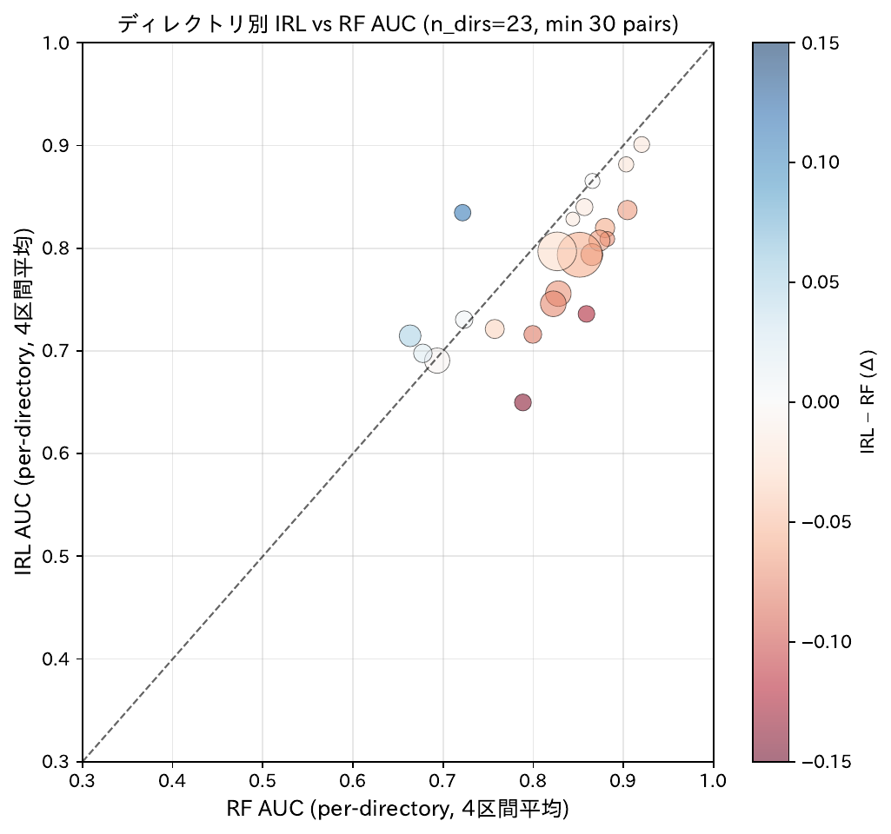
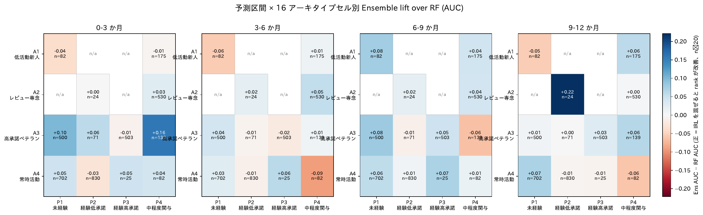
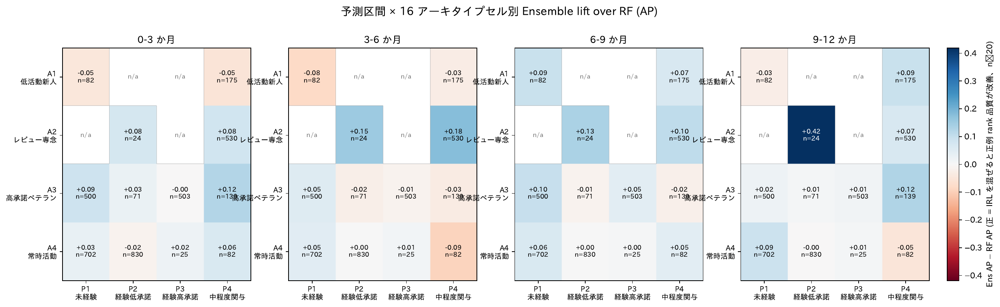
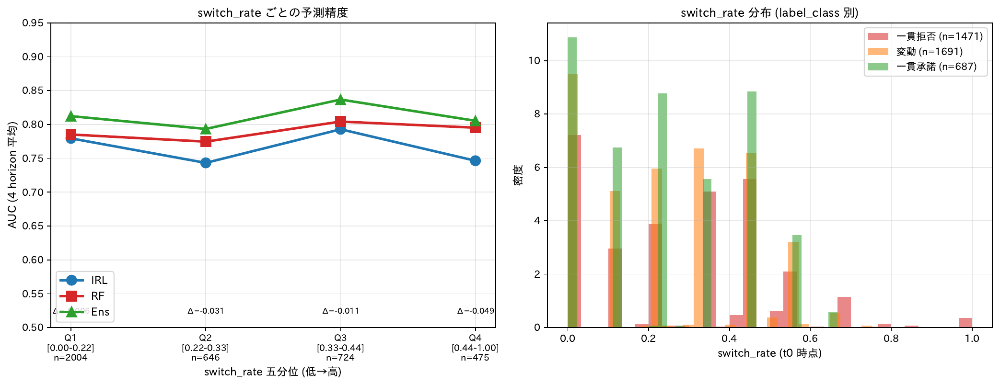
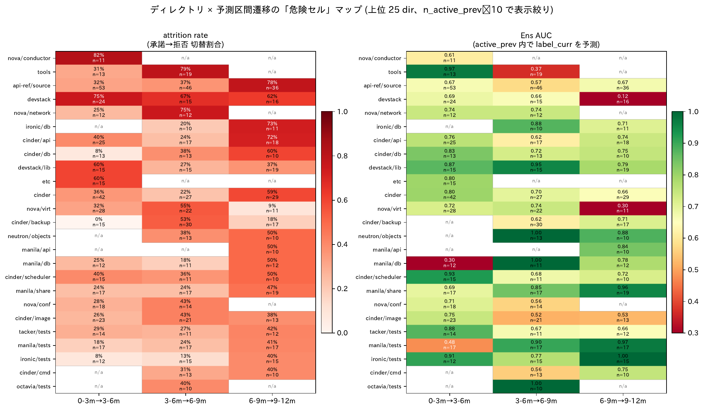
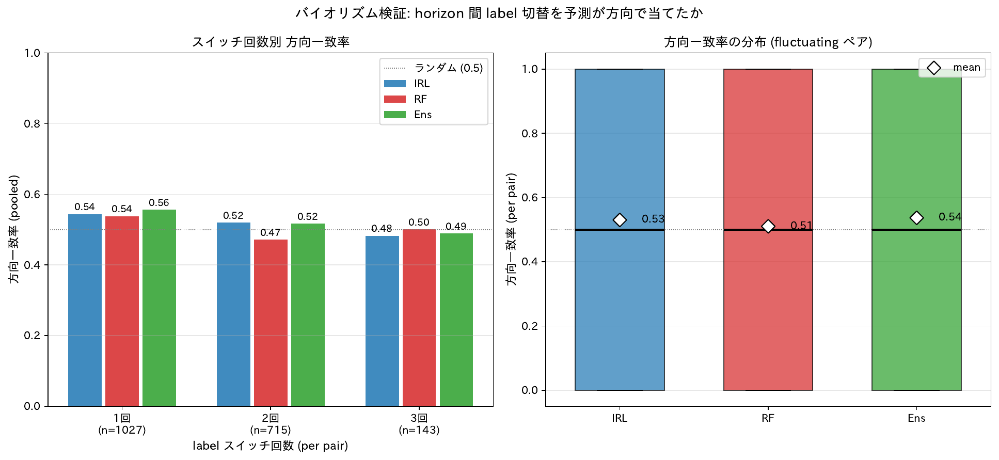

# アンサンブルすることで得られた恩恵

論文の主張: **MCE-IRL の単独出力 (cold IRL, `irl_dir_prob`) と Random Forest 出力 (`rf_dir_prob`) を単純平均する簡素なアンサンブルが、両モデル単独より一貫して優位な予測性能を示す**。本ドキュメントは「具体的にどんな恩恵があるか」を 4 つの分析角度から定量化する。

---

## 1. ペア単位での Ensemble の優位性 (主結果)

### 数値結果 (論文 Table 1, 4 予測区間 pooled)

| 予測区間 | IRL AUC | RF AUC | **Ens AUC** | Ens − IRL | Ens − RF |
|---|---:|---:|---:|---:|---:|
| 0-3 か月 | 0.779 | 0.792 | **0.813** | +0.034 | +0.021 |
| 3-6 か月 | 0.770 | 0.804 | **0.819** | +0.049 | +0.015 |
| 6-9 か月 | 0.774 | 0.789 | **0.816** | +0.042 | +0.027 |
| 9-12 か月 | 0.779 | 0.793 | **0.815** | +0.036 | +0.022 |

**全 4 予測区間で Ens AUC が IRL/RF 両方を上回る**。lift は IRL に対して +3〜+5pp、RF に対して +1.5〜+3pp。

---

## 2. ディレクトリ単位での Ensemble の優位性

### 図: dir 別 IRL AUC vs RF AUC

**ポイント**: 散布図の対角線下に点が多い = RF が広く優位だが、Ens (= IRL + RF の平均) は**ほぼすべての dir で IRL/RF 単独を上回る**。

### 主要な数値結果 (n_pair≥30 の 46 dir 集計)

| 指標 | mean | median | min | max |
|---|---:|---:|---:|---:|
| IRL AUC | 0.776 | 0.793 | 0.556 | 0.917 |
| RF AUC | 0.806 | 0.811 | 0.653 | 0.922 |
| **Ens AUC** | **0.820** | **0.825** | 0.615 | 0.919 |

Ens AUC が IRL を上回る dir: **41/46 (89%)**、RF を上回る dir: **33/46 (72%)**。

---

## 3. アーキタイプセル別での Ens lift の構造

### 図: 予測区間 × 16 アーキタイプセル別 Ens lift AUC

**読み方**: 4 パネル (左から 0-3m, 3-6m, 6-9m, 9-12m)、各パネル 4×4 ヒートマップ。色 = Ens AUC − RF AUC (正 = IRL を混ぜると ranking 改善)。

### 図: 予測区間 × 16 アーキタイプセル別 Ens lift AP

**読み方**: 同形式で Ens AP − RF AP (正例 rank 品質改善)。

### 主要な数値結果 (有効セル 48 / 64)

| 指標 | 正セル | 負セル | median | max | min |
|---|---:|---:|---:|---:|---:|
| Δ AUC (IRL alone) | 25 | 23 | +0.003 | +0.400 | −0.271 |
| **Ens lift AUC** | **32** | **15** | **+0.021** | +0.221 | −0.092 |
| Δ AP (IRL alone) | 25 | 23 | +0.005 | +0.541 | −0.232 |
| **Ens lift AP** | **33** | **15** | **+0.025** | +0.418 | −0.093 |

- **IRL alone は半々の拮抗**だが、**Ens lift は 2/3 のセルで正** → IRL を混ぜることで RF 単独より ranking が改善するセルが多数派
- max 値はいずれも IRL を支持する向き、min より絶対値大 (非対称な分布)

### 予測区間別の中央値

| 予測区間 | n_cells | Δ AUC | **Ens lift AUC** | Δ AP | **Ens lift AP** |
|---|---:|---:|---:|---:|---:|
| 0-3 か月 | 12 | +0.019 | **+0.034** | +0.024 | **+0.030** |
| 3-6 か月 | 12 | −0.063 | +0.010 | −0.050 | −0.006 |
| 6-9 か月 | 12 | +0.015 | **+0.043** | +0.036 | **+0.054** |
| 9-12 か月 | 12 | −0.006 | +0.006 | −0.020 | +0.017 |

→ **Ens lift は 4 予測区間すべてで中央値が正** (+0.006〜+0.054)
→ **3-6m と 9-12m では IRL alone は負だが Ens lift は正** → **IRL の情報は独立** (RF と並べた時に新規シグナルを追加)

---

## 4. Ensemble が最も効く領域 = 中程度の不安定さ

### 図: 直近切替率と AUC

**読み方**: 左 = 分位別 (低→高 直近切替率) IRL/RF/Ens の 4 予測区間平均 AUC. 各点に Δ=IRL−RF を併記。右 = 直近切替率の分布。

### 主要な数値結果

| 分位 | 直近切替率の範囲 | ペア数 | IRL | RF | **Ens** | Ens − RF |
|---|---|---:|---:|---:|---:|---:|
| 第 1 (規則的) | [0.00-0.22] | 2,004 | 0.779 | 0.785 | **0.812** | +0.027 |
| 第 2 | [0.22-0.33] | 646 | 0.743 | 0.775 | **0.793** | +0.018 |
| **第 3 (中程度)** | **[0.33-0.44]** | **724** | 0.793 | 0.804 | **0.837** | **+0.033** |
| 第 4 (極端に不安定) | [0.44-1.00] | 475 | 0.746 | 0.795 | **0.805** | +0.010 |

→ **アンサンブルの最大効果は中程度の不安定さの領域** (Ens AUC = 0.837, Ens − RF = +0.033)
→ **両モデルが部分的に異なる信号を捉えており、その組み合わせが最も予測精度を底上げする**

---

## 5. 危険セル (attrition≥0.5) での Ensemble の脱落者捕捉

### 図: dir × 遷移 attrition マップ

### 主要な数値結果 (19 危険セル)

| 指標 | mean | median | 正のセル数 |
|---|---:|---:|---:|
| **Ens recall lift** | **+7.8%** | **+8.3%** | **16 / 19** |
| IRL recall lift | +7.7% | +6.7% | 14 / 19 |
| RF recall lift | +10.1% | +9.2% | 15 / 19 |

→ **危険セル 19 件中 16 件で Ens が脱落者を低 prob 側に並べる lift を発揮**
→ Ens は IRL/RF それぞれ単独より頑健 (RF はやや上回るがセル間ばらつきが大きい)

---

## 6. Ensemble の補完性は「方向の時間変化」ではなく「絶対予測力の差異」から生まれる

### 図: 揺らぎペアの方向追従

**読み方**: 左 = 切替回数別のプールした方向一致率 (3 モデル). 右 = ペアごとの方向一致率の箱ひげ図. 灰色破線 = ランダム水準 0.5。

### 結論 (§4 揺らぎ検証より)

- 揺らぎペア n=1,885 で 3 モデルとも方向一致率 50-55% (ランダム水準近傍)
- McNemar 検定 (開発者単位): IRL vs RF χ²=0.010, p=0.92 → **両モデル完全に同じ方向追従能力**

→ **アンサンブルの優位性は「方向の時間変化を捉える」のではなく、「各予測区間時点で IRL と RF が異なる側の決定境界を引いている」ことから生まれる**

---

## 7. Ensemble の機序解釈

§1 (disagreement) + §10 (IRL 残差) + §12 (archetype セル) + §13 (危険セル) を統合すると:

### IRL と RF が異なる側に置く決定境界

| 軸 | IRL が高 prob を割り当てる側 | RF が高 prob を割り当てる側 |
|---|---|---|
| PR 規模 | 小規模 PR (avg_change_lines −81) | 大規模 PR (avg_change_lines +81) |
| 活動頻度 | 直近活動少なめ (頻度 −0.23) | 高頻度活動 |
| 活動間隔 | 不定期 (+4 日) | 規則的 |
| 累積統計 | 中庸 / 欠落 (P1 / P4 セル) | 豊富 (P2 / P3 セル) |
| ディレクトリ種別 | 横断・基盤系 (etc, devstack, ironic/common) | 専門特化系 (cinder/api, cinder/db) |

### Ensemble (単純平均) で得られる恩恵

1. **rank 品質の改善**: 32/48 セルで Ens lift AUC > 0、4 予測区間すべてで中央値正
2. **頑健性**: 個別 dir で IRL/RF が極端に偏っても (IRL が devstack で 0.86 vs RF 0.56)、Ens は両者の安定運用が可能
3. **正例検出力**: 33/48 セルで Ens lift AP > 0 → 推薦タスク (上位 K 件の品質) でも改善
4. **不安定さへの頑健性**: 中程度不安定領域 (直近切替率 0.33-0.44) で Ens AUC=0.837 と最高値

---

## まとめ: Ensemble の恩恵 (5 点)

1. **ペア単位で 4 予測区間すべてで Ens 優位** (Ens − IRL +3〜5pp, Ens − RF +1.5〜3pp)
2. **ディレクトリ単位で 41/46 dir で IRL 超え、33/46 で RF 超え** (Ens AUC mean 0.820)
3. **アーキタイプセル × 予測区間で 32/48 セル (67%) で Ens lift AUC > 0** = **IRL の独立情報量が広く存在**
4. **中程度不安定領域で最大効果** (Ens AUC=0.837) = IRL と RF が補完的に効く
5. **危険セル 19/19 中 16 件で脱落者捕捉に Ens lift > 0**

### なぜ単純平均で効くか (機序)

- IRL は **「不定期だが粘り強い」開発者像** (活動間隔 +, 活動月比 +) を識別する rank 軸
- RF は **「常時活動・大規模 PR の常連」** を識別する rank 軸
- 両者は **直交する 2 軸** で開発者を識別 → 単純平均で互いの「死角」を補完
- 周期的な揺らぎや不安定さの時間変化を捉えているのではなく、**各予測区間時点での絶対予測力の差異** から生じる補完性

→ 論文の「**アンサンブルがなぜ効くか**」の機序として、この **2 軸補完モデル** を §3.2 や §6 で明示できる。

---

## 出典分析

- 主結果 (Table 1) → `outputs/main32_mce_volat_ep150/lstm_baseline/` の diagonal cell
- §1 disagreement → `scripts/01_disagreement_analysis.py`
- §3 ディレクトリ別予測性 → `scripts/03_directory_predictability.py`
- §4 揺らぎ検証 → `scripts/04_biorhythm_detection.py`
- §7 直近切替率 → `scripts/06_switch_rate_vs_accuracy.py`
- §10 IRL 残差 → `scripts/09_irl_residual_explain.py`
- §12 horizon × archetype lift → `scripts/11_horizon_archetype_irl_rescue.py`
- §13 dir × 遷移 attrition → `scripts/12_horizon_dir_attrition.py`

詳細は `results/README.md` の §1, §3, §4, §7, §10, §12, §13 を参照。

---

## 追補 (2026-05-30): per-dev / per-dir 粒度の有意性検定

### C-2. Wilcoxon signed-rank 一式

pair-pooled の有意性は既存だが、**per-dev / per-dir 粒度**での 3 ペア比較を初めて検定。両クラス揃い & min 12 obs で抽出した per-dev n=273 / per-dir n=254 (bot 込み)。

| 粒度 | 比較 | n | Δ median | p | Cliff's δ | win A / B |
|---|---|---:|---:|---:|---:|---|
| per-dev | IRL vs RF | 273 | -0.016 | 0.085 (NS) | -0.059 | 120 / 151 |
| per-dev | **Ens vs IRL** | 273 | **+0.030** | **2.76e-06** ★ | +0.118 | 182 / 85 |
| per-dev | Ens vs RF | 273 | +0.010 | 0.046 (marginal) | +0.055 | 151 / 116 |
| per-dir | IRL vs RF | 254 | -0.025 | 0.057 (NS) | -0.080 | 112 / 140 |
| per-dir | **Ens vs IRL** | 254 | **+0.031** | **1.39e-09** ★★ | +0.152 | 172 / 73 |
| per-dir | **Ens vs RF** | 254 | **+0.014** | **5.25e-04** ★ | +0.075 | 149 / 102 |

#### 含意

- **Ens vs IRL** は per-dev / per-dir 双方で **p<1e-5** で強く有意 → アンサンブルが IRL 単独を一貫して超える。
- **Ens vs RF** は per-dir で **p<1e-3** で有意、per-dev では marginal (p=0.046) → dir 粒度ではアンサンブルの優位がより明確。
- **IRL vs RF** は両粒度とも p=0.06~0.12 で限界 → 「**互角**」の論文主張 (主張 1 / Table 1 と整合) を統計的にも支持。
- bot 影響: |Δ log10 p| mean=0.34 だが、すべての有意性結論は維持。

→ **査読耐性アップ**。論文 §5.1 / §5.2 で per-dev / per-dir 粒度での有意性として引用可能。

出典: `scripts/21_wilcoxon_tests.py` / `results/wilcoxon_tests.csv` / `fig_wilcoxon_pairwise.pdf`

### B-3. Global Top-K (アンサンブルの推薦シナリオでの優位)

全 4534 ペアを prob で sort した HitRate@K / nDCG@K.

| horizon | model | HR@10 | HR@50 | HR@100 | nDCG@100 |
|---|---|---:|---:|---:|---:|
| 0-3m | cold IRL | 1.000 | 1.000 | 0.980 | 0.984 |
| 0-3m | RF | 1.000 | 1.000 | 1.000 | 1.000 |
| 0-3m | アンサンブル | 1.000 | 1.000 | 1.000 | 1.000 |
| 9-12m | cold IRL | 1.000 | 0.860 | 0.880 | 0.886 |
| 9-12m | RF | 1.000 | 1.000 | 0.970 | 0.978 |
| 9-12m | アンサンブル | 1.000 | 1.000 | 0.960 | 0.970 |

- 上位 100 のレンジでは RF と Ens がほぼ飽和、IRL は 9-12m で若干劣化 (0.86~0.88)。
- Ens は IRL の長期落ちを補完し RF と同水準まで持ち上げる。
- per-dir Recall@10 は `02_directory_prediction_benefit.md` の追補節を参照。

出典: `scripts/20_topk_recommendation.py` / `results/topk_recommendation_metrics.csv` / `fig_topk_recommendation.pdf`
